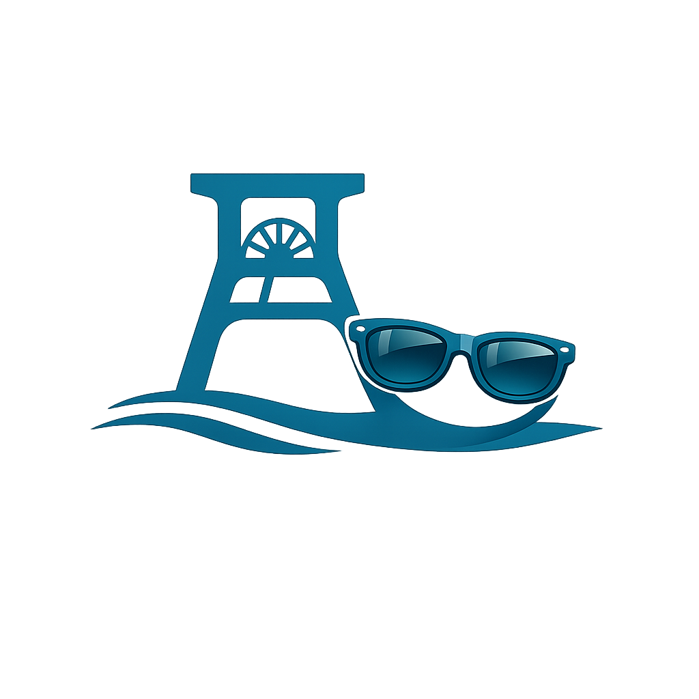
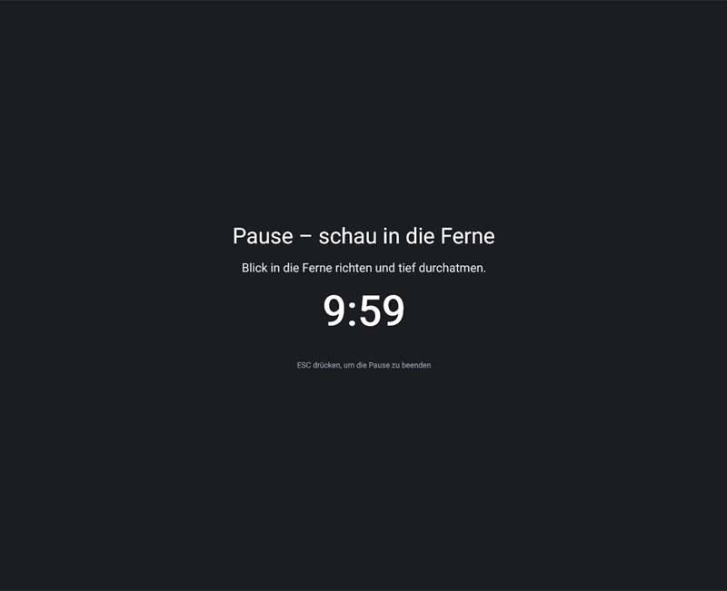
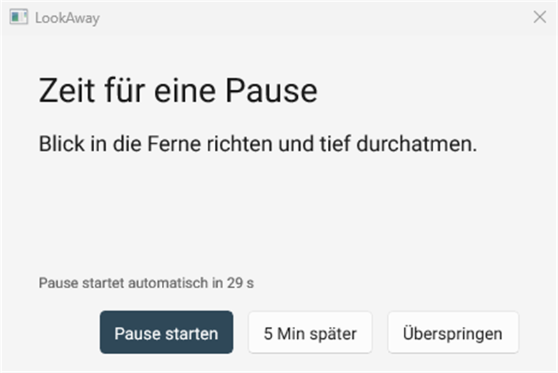
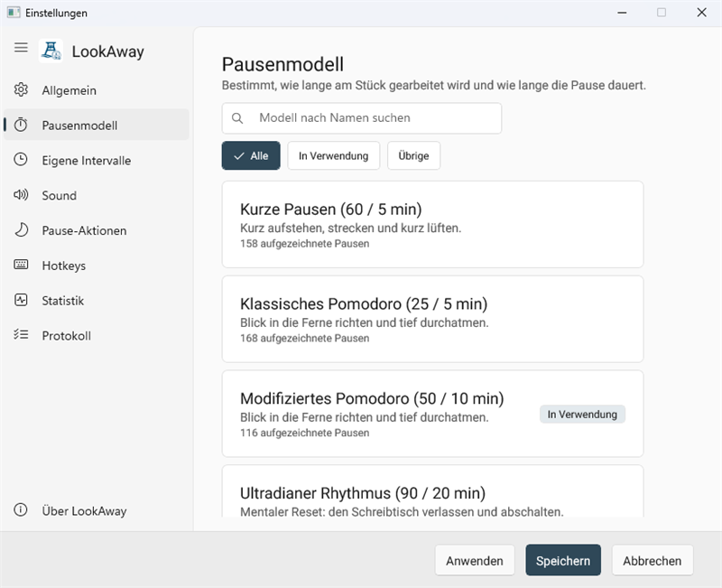
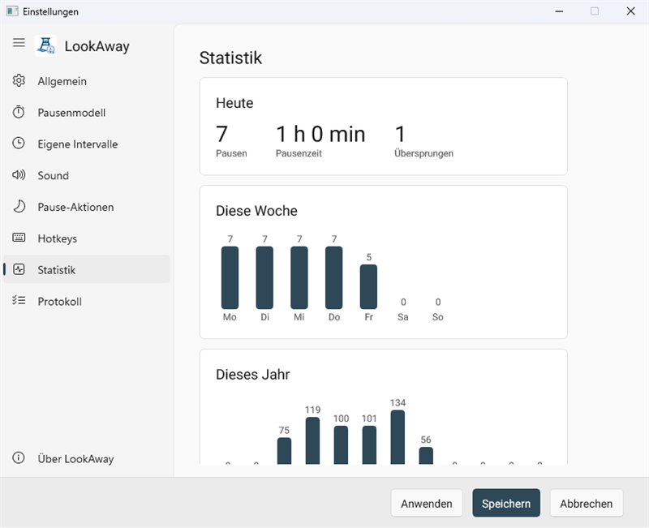
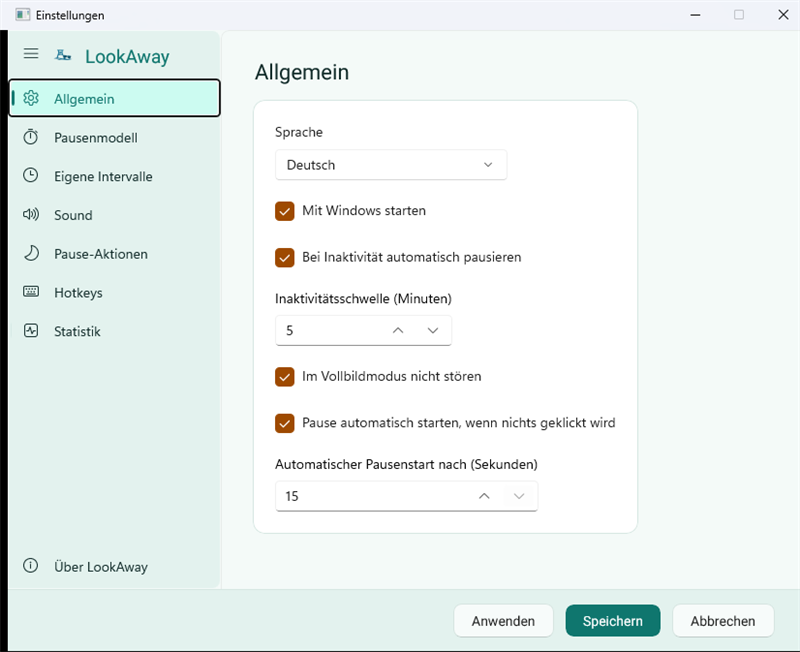
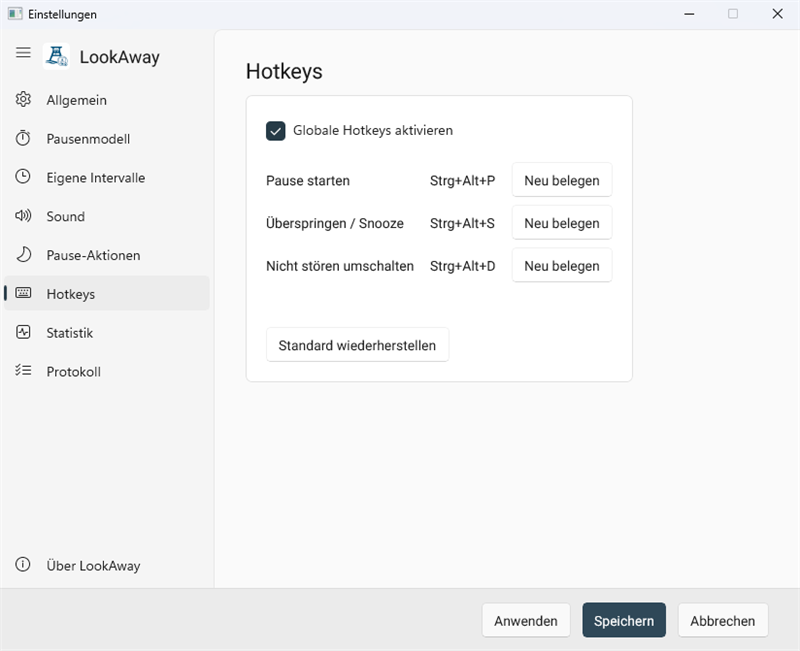

<div align="center">



# LookAway

**Erinnert an Bildschirmpausen.**

[](https://github.com/ReneSchustek/LookAway/actions/workflows/ci.yml)
[](https://github.com/ReneSchustek/LookAway/releases/latest)

**Deutsch** · [English](README.en.md) · [Français](README.fr.md)

</div>

LookAway ist eine kleine Windows-Tray-Anwendung, die an Bildschirmpausen erinnert, ohne zu stören.
Sie läuft im Hintergrund, bringt mehrere wissenschaftlich begründete Pausenmodelle mit und lässt
sich für jeden Windows-Benutzer eigens einstellen. Gedacht ist sie für alle, die viel am Bildschirm
arbeiten und dabei Augen, Haltung und Konzentration schonen möchten.

## Aktuelles Release

**[v1.5.1](https://github.com/ReneSchustek/LookAway/releases/latest)** ist die aktuelle Version,
zu haben als Setup.exe und als portable ZIP. Das hat sich zuletzt getan:

- **Eigenes Bild für die Pause:** Statt der Farbe zeigt der Pausen-Bildschirm auf Wunsch ein eigenes
  Foto, über alle Monitore und mit einstellbarer Abdunklung.
- **Installation unter `C:\Program Files`:** Das Setup löst eine Installation im Benutzerprofil ab;
  Aktualisierungen kommen über das signierte Setup und werden erst auf Klick installiert.
- **Startbild und neue Schrift:** LookAway zeigt beim Start Logo und Version und trägt durchgehend
  Roboto Flex, mitgeliefert und ohne Abruf aus dem Netz.
- **Das Pausen-Overlay liegt zuverlässig über allem**, auf jedem Monitor, bis zum äußersten
  Bildpunkt und ohne Eintrag in Taskleiste und Alt-Tab. **Strg + Alt + S** beendet eine laufende
  Pause.
- **Helles und dunkles Erscheinungsbild:** frei wählbar oder der Windows-Einstellung folgend. Die
  Wahl wirkt sofort im offenen Fenster.
- **Aufgaben (aufgabenbasiertes Modell):** Die Aufgaben, an denen gerade gearbeitet wird, stehen
  in einer Liste mit Suche und Filter, und jede Pause wird der laufenden Aufgabe zugeordnet.
- **Protokoll im Programm:** die zuletzt festgehaltenen Meldungen mit Suche und Filtern nach Stufe
  und Zeitraum. Daneben liegen sie weiter als Datei im Datenverzeichnis.
- **Pausenmodelle als Kacheln** mit Suchfeld und Filterleiste. Jede Kachel nennt, was in der Pause
  zu tun ist und wie viele Pausen daraus entstanden sind.
- **Signierte Updates:** Jedes Paket wird vor dem Einspielen gegen eine ECDSA-P-256-Signatur geprüft
  und ohne gültige Signatur abgelehnt.
- **Ein-Klick-Installation:** „Auf Updates prüfen" spielt ein gefundenes Paket direkt ein, ohne Umweg
  über die Release-Seite.

## Funktionen

- **7 Pausenmodelle:** Pomodoro, Modifiziertes Pomodoro, Ultradianer Rhythmus, Physical Counter,
  Kurze Pausen, Aufgabenbasiert und gesetzliche Empfehlung
- **Auto-Pause und Nicht stören:** pausiert bei Inaktivität und hält Erinnerungen zurück, solange
  Vollbild-Apps laufen (Präsentationen, Filme, Spiele)
- **Timer-Reset nach Abwesenheit:** Nach Standby oder längerer Inaktivität (z. B. Telefonat) beginnt
  die Arbeitszeit von vorn, denn die Augen haben ohnehin pausiert
- **Abgedunkelter Pausen-Screen:** Ein ruhiges Vollbild-Overlay verdeckt den Bildschirm während der
  Pause, zeigt den Countdown und das Übungs-Ziel und lässt sich jederzeit mit **ESC** beenden;
  optional auf **allen Monitoren**, in **frei wählbarer Farbe** oder mit einem **eigenen Bild** (etwa
  einem Waldfoto), über das sich eine einstellbare Abdunklung legt. Es liegt über allen Fenstern und
  über der Taskleiste und erscheint dabei weder in der Taskleiste noch im Alt-Tab-Umschalter
- **Pause-Aktionen:** Bildschirm dimmen (DDC/CI) und Medienwiedergabe während der Pause pausieren
  (nur Player mit Windows-Mediensteuerung wie Spotify, Musik-App, Chrome/Edge/Firefox; VLC wird nicht unterstützt)
- **Automatische Updates:** optionale Prüfung über die GitHub-Releases-API; auf Wunsch lädt und
  installiert LookAway neue Versionen selbst (siehe [Updates](#updates))
- **Helles und dunkles Erscheinungsbild:** frei wählbar oder der Windows-Einstellung folgend
- **Dreisprachig:** Deutsch, Englisch, Französisch, live umschaltbar
- **Statistiken und CSV-Export:** Pausen pro Tag, Woche und Jahr, exportierbar
- **Protokoll im Programm:** die zuletzt festgehaltenen Meldungen mit Suche und Filter nach Stufe
  und Zeitraum, hilfreich, wenn etwas nicht so läuft wie erwartet
- **Globale Hotkeys:** Pause starten, überspringen, Nicht stören, von überall aus
- **Optionaler Ton:** dezenter Hinweis bei der Erinnerung (aus drei Tönen wählbar)
- **Autostart:** startet auf Wunsch automatisch mit Windows

## Voraussetzungen

- Windows 10 (Version 1809) oder neuer / Windows 11

## Installation

Die fertige Anwendung liegt in zwei Varianten auf der
[Releases-Seite](https://github.com/ReneSchustek/LookAway/releases/latest): als **Setup.exe** und
als **portables ZIP**.

### Setup.exe

1. `LookAway-Setup-<Version>.exe` herunterladen und ausführen.
2. Der Installer fragt nach Administratorrechten und installiert unter `C:\Program Files\LookAway`,
   mit Startmenü-Eintrag und optionalem Autostart. Eine frühere Installation im Benutzerprofil löst er
   dabei ab; Einstellungen und Verlauf bleiben erhalten. Deinstalliert wird über „Apps & Features".

### Portable

1. `LookAway-Portable-<Version>.zip` von der Releases-Seite herunterladen und in einen beliebigen
   Ordner entpacken.
2. `LookAway.exe` starten. Im Portable-Modus liegen alle Daten neben der EXE, passend für den USB-Stick.

> Hinweis: Die Builds sind nicht mit einem CA-Zertifikat signiert, deshalb kann Windows SmartScreen beim
> ersten Start warnen („Weitere Informationen" → „Trotzdem ausführen"). Der Release-Text nennt zu jeder Datei
> den SHA-256; damit lässt sich ein Download vor dem Start prüfen:
> `Get-FileHash .\LookAway-Setup-<Version>.exe -Algorithm SHA256`.

### Selbst bauen

Beide Artefakte entstehen auch lokal, dazu ein **MSIX-Paket**, das nicht veröffentlicht wird:

```powershell
# Programmordner UND Setup.exe zur Weitergabe (benötigt Inno Setup):
tools\publish.ps1

# Portable ZIP:
tools\publish-portable.ps1 -Version <Version>

# nur die Setup.exe nach dist\ (benötigt Inno Setup):
tools\publish-setup.ps1 -Version <Version>

# MSIX-Paket:
msbuild src\LookAway.App\LookAway.App.csproj -p:Configuration=Release -p:Platform=x64 `
  -p:WindowsPackageType=MSIX -p:GenerateAppxPackageOnBuild=true
```

## Erste Schritte

Beim ersten Start führt ein kurzer Assistent in drei Schritten durch die Einrichtung: Sprache,
Pausenmodell und Autostart. Danach sitzt LookAway im Tray. Ein Klick auf das Symbol öffnet das Menü,
ein Doppelklick die Einstellungen.

## Konfiguration

Alle Optionen finden sich im Einstellungsfenster (Tray-Menü → „Einstellungen…") im aufklappbaren
Seitenmenü: Allgemein (inkl. Erscheinungsbild), Pausenmodell, eigene Intervalle, Sound, Pause
(inkl. Bildschirm-Abdunkelung, Hintergrund als Farbe oder eigenes Bild), Hotkeys, Statistik, Protokoll und Über (mit
Update-Optionen).

Die Pausenmodelle stehen als Kacheln mit Suchfeld und Filterleiste: Jede zeigt, was in der Pause
zu tun ist und wie viele Pausen daraus bereits entstanden sind. Ein Klick wählt das Modell.

## Updates

LookAway kann sich selbst aktuell halten:

- Ist die Update-Prüfung aktiv und eine neue Version verfügbar, erscheint im Tray der Eintrag „Update".
- **Installierte Kopie:** Ein Klick lädt das Setup der neuen Version und startet es; Windows fragt
  dabei nach Administratorrechten. Das Setup beendet LookAway, installiert und startet es wieder.
  Mit **„Automatisch aktualisieren"** wird das Setup schon im Hintergrund geladen und geprüft,
  installiert wird aber erst auf Klick, damit die Rechteabfrage nie ungefragt erscheint.
- **Portable Kopie:** Ein Klick lädt die neue Portable-ZIP, ersetzt nach dem Beenden die
  Programmdateien und startet neu; mit „Automatisch aktualisieren" geschieht das beim nächsten Start
  ganz ohne Zutun.
- Setup und ZIP tragen je eine Signatur, die LookAway vor dem Start bzw. Einspielen prüft; der
  Download läuft ausschließlich über HTTPS von GitHub.

## Pausenmodelle

| Modell | Arbeit | Pause | Empfohlen für |
|---|---|---|---|
| Kurze Pausen | 60 min | 5 min | Lange, ruhige Arbeitsphasen |
| Klassisches Pomodoro | 25 min | 5 min | Fokussiertes Arbeiten in Etappen |
| Modifiziertes Pomodoro | 50 min | 10 min | Längere Konzentrationsblöcke |
| Ultradianer Rhythmus | 90 min | 20 min | Tiefe Arbeit nach dem natürlichen Rhythmus |
| Physical Counter | 40 min | 2 min | Haltung und Mikropausen |
| Aufgabenbasiert | bis 120 min | 10 min | Arbeiten bis zum Meilenstein |
| Gesetzliche Empfehlung | 120 min | 15 min | Bildschirmarbeit nach Vorgabe |

## Hotkeys (Standard)

| Aktion | Tastenkombination |
|---|---|
| Pause starten | `Strg + Alt + P` |
| Überspringen / Snooze | `Strg + Alt + S` |
| Nicht stören umschalten | `Strg + Alt + D` |

Die Hotkeys lassen sich in den Einstellungen aktivieren oder auf die Standardwerte zurücksetzen.

Läuft gerade eine Pause, beendet „Überspringen / Snooze" sie. Das ist neben **ESC** der zweite Weg aus
dem bildschirmfüllenden Overlay.

## Datenschutz

LookAway ist datensparsam und arbeitet vollständig lokal:

- **Was gespeichert wird:** Einstellungen, Pausen-Historie und Logdateien, ausschließlich auf dem
  eigenen Gerät unter `%APPDATA%\LookAway` (bzw. neben der EXE im Portable-Modus).
- **Was nicht passiert:** Es werden keine Nutzungsdaten, keine Telemetrie und keine persönlichen
  Daten an Server gesendet.
- **Einzige Netzwerkverbindung:** Die optionale Update-Prüfung fragt die öffentliche
  GitHub-Releases-API ab, ob eine neuere Version vorliegt. Sie lässt sich in den Einstellungen
  abschalten.

## Screenshots



*Der Pausen-Screen verdeckt den Bildschirm, zeigt Ziel und Countdown und endet mit **ESC**.*



*Die Erinnerung: Pause starten, verschieben oder überspringen. Ohne Klick beginnt sie von selbst.*



*Pausenmodelle als Kacheln mit Suche und Filter. Jede nennt, was in der Pause zu tun ist.*



*Statistik: Pausen pro Tag, Woche und Jahr, als CSV exportierbar.*



*Einstellungen: Erscheinungsbild, Sprache, Autostart und Auto-Pause.*



*Globale Hotkeys: Jede Aktion lässt sich über „Neu belegen" auf eine eigene Tastenkombination legen.*

Weitere Aufnahmen liegen unter [`docs/screenshots/`](docs/screenshots/).

## Changelog

Die Versionshistorie steht in [`CHANGELOG.md`](CHANGELOG.md).

## Für Entwickler

Architektur, Build, Tests und die internen Details sind in [`docs/DEVELOPMENT.md`](docs/DEVELOPMENT.md)
beschrieben.

## Weiterarbeiten

Das Projekt ist seit dem 23.11.2026 abgeschlossen: Es gibt keine offenen Aufgaben, die Fassung 1.5.1
ist veröffentlicht, und installierte Kopien aktualisieren sich über die GitHub Releases. Für
Änderungen wird es wieder geöffnet:

1. Das Repository klonen und `dotnet build LookAway.slnx` ausführen; die Tests mit `dotnet test`.
2. Starten mit `dotnet run --project src/LookAway.App`. Eine installierte LookAway-Instanz vorher
   beenden: Es läuft immer nur eine Instanz je Benutzer, und ist der Autostart eingeschaltet, trägt
   jeder Start seinen eigenen Pfad ein; danach die installierte Fassung einmal starten.
3. Alles Weitere (Aufbau, Release, Signatur, Messungen) steht in
   [`docs/DEVELOPMENT.md`](docs/DEVELOPMENT.md), der Verlauf in [`CHANGELOG.md`](CHANGELOG.md).

## Lizenz

MIT-Lizenz, siehe [LICENSE](LICENSE).

Die mitgelieferten Schriften **Roboto Flex** und **Roboto Mono** stehen unter der SIL Open Font
License 1.1; die Lizenztexte liegen bei den Schriftdateien unter `src/LookAway.App/Assets/Fonts/`
(`OFL-roboto-flex.txt`, `OFL-roboto-mono.txt`). Zur Laufzeit lädt LookAway keine Schrift aus dem Netz.
